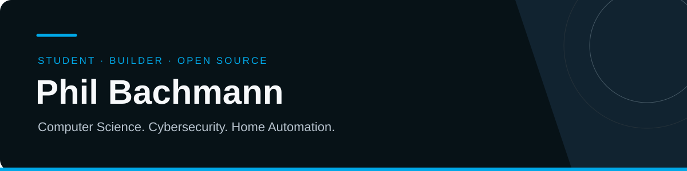

  

  <a href="https://bachmann-it.com">Website</a> &nbsp;·&nbsp;
  <a href="https://github.com/Phil-0805/hoymiles-home-assistant">Hoymiles integration</a> &nbsp;·&nbsp;
  <a href="https://github.com/Phil-0805/hoymiles-home-assistant/discussions">Community</a>

## Hi, I'm Phil 👋

I'm a Computer Science student at **Westfälische Hochschule** in Germany, interested in cybersecurity, software development and home automation.

I enjoy building things that solve problems I run into myself—and learning how they work along the way. Alongside my studies, I run **[IT.Service Bachmann](https://bachmann-it.com)**, helping with websites, IT support and networks.

## What I'm building

### ☀️ Hoymiles S-Miles Home for Home Assistant

An independent community integration connecting Hoymiles solar and battery systems to **Home Assistant**, available through **HACS**.

It started with wanting to connect my own setup. Since then, it has grown into an open-source project shaped by community feedback and testing across different installations.

[Explore the project →](https://github.com/Phil-0805/hoymiles-home-assistant) &nbsp; [Join the discussions →](https://github.com/Phil-0805/hoymiles-home-assistant/discussions)

### 🛠️ Personal dashboard / private repository

I'm also building a personal dashboard to organise my calendar, projects and everyday tasks. It's a learning project where I write the code myself to put what I learn at university into practice.

## What I'm exploring

- **Cybersecurity**: developing my skills through university, hands-on labs and personal projects.
- **Home automation**: connecting devices and building useful automations with Home Assistant.
- **Homelab & networking**: running self-hosted services and experimenting with networks.
- **Software development**: turning ideas into working projects and understanding the code behind them.

## Let's connect

Questions, device compatibility feedback and contributions to the Hoymiles integration are welcome in the [project discussions](https://github.com/Phil-0805/hoymiles-home-assistant/discussions).

For my IT services and business enquiries, visit **[bachmann-it.com](https://bachmann-it.com)**.
